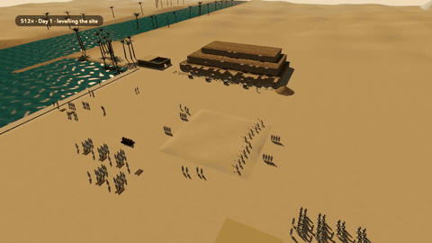
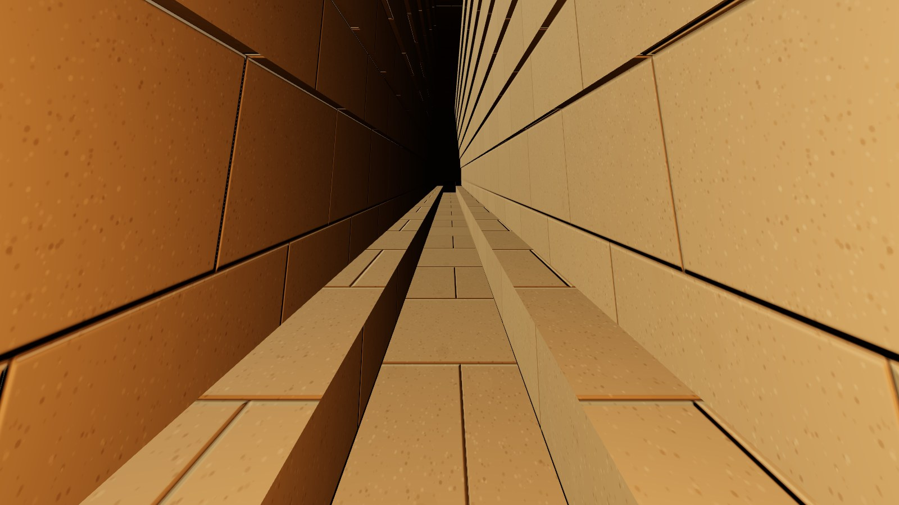

# Pyramid Builders

A 3D simulation of an Old Kingdom work crew building a small pyramid, from levelling the bedrock to a furnished tomb. Every worker, boat, stone and ramp is driven by a deterministic simulation. Nothing is scripted or keyframed, and every texture and model is generated in code with [three.js](https://threejs.org).

**[Play it in your browser](https://chambsnoah.github.io/pyramid-builders/)** · **[Watch the 2-minute guided tour (MP4)](media/pyramid-tour.mp4)**



*The whole build at 512× speed: 70 seconds from bare bedrock to the finished pyramid. ([MP4 version](media/build-512x.mp4))*

## Run it

```bash
npm install
npm run dev
```

Then open http://localhost:5174.

## What you can do

- **Timeline:** play, pause, set the speed from 1× to 1024×, jump a day forward or back, or drag to any point in the build. The random numbers are seeded, so every replay is the same build.
- **X-ray:** see the passages, chambers and rock-cut galleries through the masonry and the bedrock.
- **Walk:** explore in first person (WASD, drag to look, Shift to run). Look at a stone, chest or statue to see what it is, and press E to open a chest.
- **Tour:** a guided run from the first day to the finished tomb, with captions.

## What is simulated

- **Supply:** boats carry Tura limestone casing, Aswan granite, timber, gypsum and food up the Nile into a harbour basin. A harbour master orders cargo as stocks run low. Stevedores lever stones ashore.
- **Quarry:** pairs of quarrymen cut core blocks from a terraced quarry next to the site. Loaders move the blocks to a yard where masons dress the casing to the slope.
- **Hauling:** teams drag each stone on a sled up one of two rubble ramps while a water carrier wets the sand. Stones are pushed across the course and levered into place, farthest first, so no gap is walled in. Carpenters lay timber centering over the openings.
- **Underground:** diggers cut a descending stair, a passage and a burial chamber into the bedrock. Spoil carriers take the rubble to a heap.
- **Interior:** an entrance passage, an antechamber, an ascending stair and a granite-lined burial chamber. The sarcophagus is hauled in before the roof goes on.
- **Finish:** the ramps are taken down from the top, revealing the white casing. Then porters carry chests and statues into both chambers.

Workers find paths on a navigation grid with A*, step aside for each other and queue on the ramps, so they do not walk through walls, buildings or one another.

## Khufu's pyramid (work in progress)

**[Open the full-size Great Pyramid](https://chambsnoah.github.io/pyramid-builders/khufu.html)** (`khufu.html`; locally http://localhost:5174/khufu.html)

Simulating the Great Pyramid of Khufu at full size ([plan: issue #1](https://github.com/chambsnoah/pyramid-builders/issues/1)): 230.3 m square and 146.6 m high, with 215 courses and a pyramidion. You can scrub through its 20-year build, see through it in X-ray and walk through its interior.

- **Timeline in years:** play and pause, set the speed (from 1× real working time to a year a second), step a day or a month either way (←/→, Shift for a month), or drag to any working day. The clock shows the year of the build, the season and month (Akhet, Peret, Shemu), the day and the hour. Diamonds on the timeline mark milestones, such as the Queen's Chamber and King's Chamber roofed, the Grand Gallery complete, the ramps switching to zigzags and the capstone set; click one to jump there. On load the page shows the finished monument; `?year=9` or `?day=1500` opens at another time, and `&play` starts playing.
- **The build, course by course:** the finished courses are drawn as surfaces and the course being laid block by block, with the stones being levered into place in gold, all read from the event model at the time on the timeline.
- **Statistics:** blocks set, blocks per working day (with a chart of the whole build), workers on site and the sled gangs out, coming back or waiting, the quarry yard and the casing on the quay, and the longest queues right now on the ramps, landings, berths and loading bays.

- **Walk:** the buttons (or keys 1–6) jump to the north side, the entrance, the subterranean chamber, the Queen's Chamber, the Grand Gallery or the King's Chamber. You crouch automatically in the low passages. Where one passage leaves through the roof of another (the ascending passage opens in the roof of the descending one), a "Space · climb up" prompt appears; press Space to scramble up. Walking into a ledge you can climb (the rock terraces in the subterranean chamber) climbs it after a moment, and walking into the wall beside a narrow doorway slides you into it.
- **Courses:** the slider jumps to the day any course was finished and shows the rooms in section.
- The course heights are pinned to Petrie's levels for the thick courses (1883, sec. 146). The rooms and passages are placed from Petrie's survey and standard plans. `src/khufu/data.js` notes the sources and which figures are approximate.

| Entrance | Grand Gallery | King's Chamber |
| --- | --- | --- |
|  |  |  |

### The 20-year build as an event model

`src/khufu/sim/` simulates the logistics of the whole build without graphics. In the browser it runs in a Web Worker (`src/khufu/sim/worker.js`): the full build takes about 2.2 s there when the page opens, then the timeline asks the worker for the state at each time it shows. A seek restores the month's snapshot and replays at most a month of events, so any day is reached in about 10 ms (30 ms at worst), backward or forward.

```bash
npm run khufu:sim                                  # full build, report in the terminal (~2.5 s)
npm run khufu:sim -- --seed 7 --set haul.gangs=80  # other seeds and settings
npm run khufu:check                                # determinism, snapshot replay and calibration checks
npm run khufu:seek                                 # seek times and exactness, as the timeline seeks
```

- **Discrete events, not ticks.** Quarry faces cut blocks; sled gangs haul them along a road graph to a ramp; ramp lanes, loading bays, landings and harbour berths are first-come-first-served resources with queues; setting crews lay them. Boats bring the Tura casing, yearly convoys the Aswan granite, and heavy gangs take the granite and the roof beams up a whole ramp width at a time.
- **Courses are planned in sectors**, each with its own landing and crews, and blocks are set farthest-first from the landing. Room voids stay open, and the King's Chamber, relieving chambers, Grand Gallery and Queen's Chamber get their linings and roof beams as their courses pass.
- **Ramp theory: straight ramps, then zigzags.** Up to 45 m a straight 1:8 ramp stands against each face. Above that the sleds climb those ramps, then switch back up the faces on 1:6 zigzags. Other theories plug into `src/khufu/sim/ramps/`.
- **Time** is working time: days of 10 hours, years of 300 days. Every run with the same seed is identical, and the state is saved every simulated month so any day can be reached by restoring the month before it and replaying.
- **Calibration:** with the defaults (`src/khufu/sim/params.js`), 2,295,833 blocks take 19.97 years, 38.3 blocks an hour, against the 38.3 of issue #1. The number of quarry crews is the main knob: quarrying limits the first 15 years, hauling up the zigzags the last few.

## Code map

| File | What it does |
| --- | --- |
| `src/plan.js` | Pyramid grid, courses, voids, rock cells and setting order |
| `src/sim.js` | Simulation clock, sleds, ramps, dispatch of stones to crews |
| `src/crews.js` | Quarrymen, haulers, masons, water carriers, harbour officials |
| `src/works.js` | Tunnelling, spoil, ramp raising, furnishing the tomb |
| `src/boats.js` | Boats, harbour berths, stevedores and porters |
| `src/nav.js` | Occupancy grid, A* paths, sidestepping |
| `src/core.js` | Paths, cooperative behaviours (generators), seeded random |
| `src/pyramid.js` | Instanced stones, X-ray, rock and timber meshes |
| `src/world.js` | Terrain, river, harbour, quarry, storehouse, camp |
| `src/workers.js` | Instanced crowd with poses and carried items |
| `src/fps.js` | First-person walking and collision |
| `src/tour.js` | Guided tour script and caption overlay |
| `src/main.js` | Renderer, HUD, timeline, inspect, tour recorder |
| `src/khufu/data.js` | Khufu: dimensions, course heights, rooms as volumes, sources |
| `src/khufu/monument.js` | Khufu: casing surfaces per course, cap, pyramidion, far hull |
| `src/khufu/rooms.js` | Khufu: room and passage linings cut from the volumes |
| `src/khufu/collision.js`, `walker.js` | Khufu: sparse column collision and first-person walking |
| `src/khufu/main.js` | Khufu: scene, X-ray, HUD, wiring of the timeline to the renderer, frame-rate and seek measurement |
| `src/khufu/timeline.js` | Khufu: the worker client (one seek in flight), timeline controls, milestones, historical clock |
| `src/khufu/statsPanel.js` | Khufu: statistics panel and blocks-per-day chart |
| `src/khufu/working.js` | Khufu: the course being laid, one instanced block per stone set |
| `src/khufu/sim/` | Khufu: 20-year event model (queue, resources, roads, planner, ramp theories, model) |
| `src/khufu/sim/view.js`, `worker.js` | Khufu: what the page reads from the model at a time (panels, course layout, milestones, seeking), and the worker that runs it |
| `scripts/khufu-sim.mjs`, `khufu-sim-check.mjs`, `khufu-seek.mjs` | Khufu: run the model, check it, time seeks |

## Making the video

The tour renders frame by frame. With the dev server running, open the app and call `__record()` in the browser console. Frames are saved to `recording/frames`. Then encode them:

```bash
ffmpeg -framerate 30 -i recording/frames/f%05d.jpg -c:v libx264 -pix_fmt yuv420p -crf 20 media/pyramid-tour.mp4
```

The 512× GIF works the same way: call `__recordRun()` (defaults: 512×, 15 fps, the camera circling once), then encode:

```bash
ffmpeg -framerate 15 -i recording/frames/f%05d.jpg -vf "fps=10,scale=480:-1:flags=lanczos,split[a][b];[a]palettegen=max_colors=64[p];[b][p]paletteuse=dither=none:diff_mode=rectangle" media/build-512x.gif
```

## Deploying

Every push to `main` builds the site with Vite and publishes `dist/` to GitHub Pages (`.github/workflows/pages.yml`).
