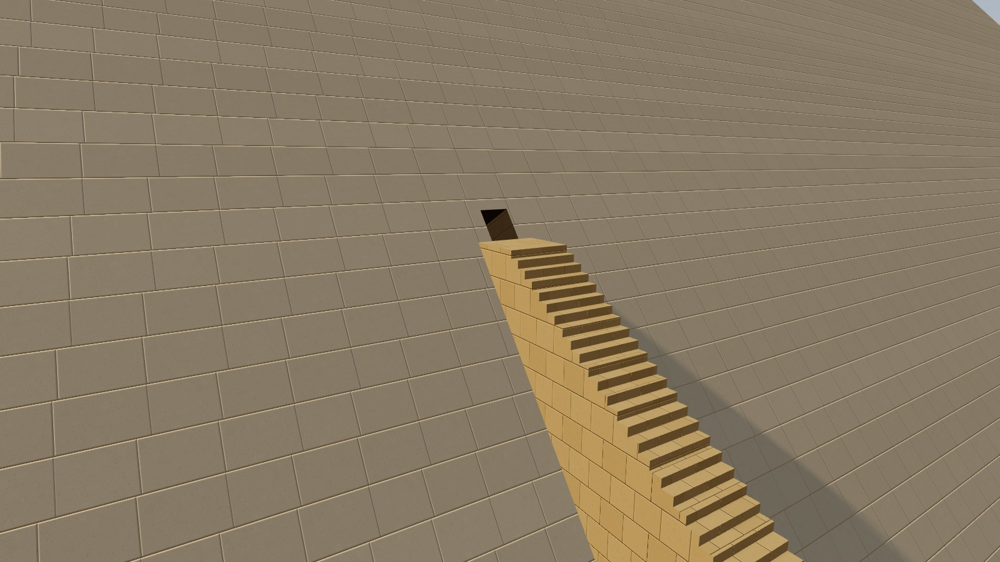
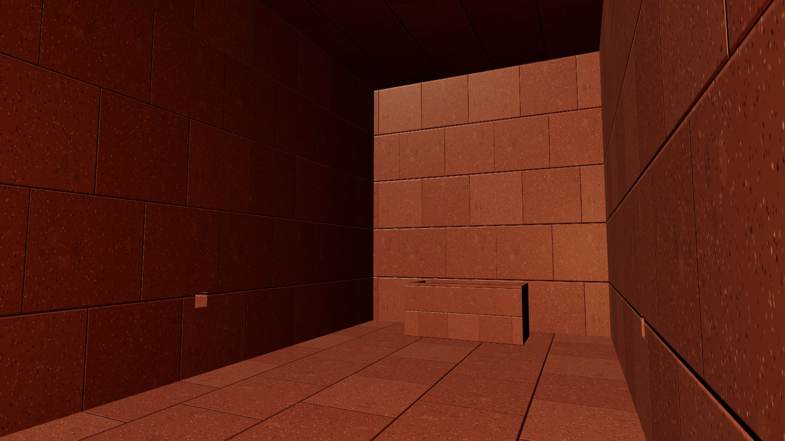

# Pyramid Builders

A 3D simulation of an Old Kingdom work crew building a small pyramid, from levelling the bedrock to a furnished tomb. Every worker, boat, stone and ramp is driven by a deterministic simulation. Nothing is scripted or keyframed, and every texture and model is generated in code with [three.js](https://threejs.org).

**[Play it in your browser](https://chambsnoah.github.io/pyramid-builders/)** · **[Watch the 2-minute guided tour (MP4)](media/pyramid-tour.mp4)**


*The whole build at 512× speed: 70 seconds from bare bedrock to the finished pyramid. ([MP4 version](media/build-512x.mp4))*

## Run it

```bash
npm install
npm run dev
```

Then open http://localhost:5174.

## What you can do

- **Timeline:** play, pause, set the speed from 1× to 1024×, jump a day forward or back, or drag to any point in the build. The random numbers are seeded, so every replay is the same build.
- **X-ray:** see the passages, chambers and rock-cut galleries through the masonry and the bedrock.
- **Walk:** explore in first person (WASD, drag to look, Shift to run). Look at a stone, chest or statue to see what it is, and press E to open a chest.
- **Tour:** a guided run from the first day to the finished tomb, with captions.

## What is simulated

- **Supply:** boats carry Tura limestone casing, Aswan granite, timber, gypsum and food up the Nile into a harbour basin. A harbour master orders cargo as stocks run low. Stevedores lever stones ashore.
- **Quarry:** pairs of quarrymen cut core blocks from a terraced quarry next to the site. Loaders move the blocks to a yard where masons dress the casing to the slope.
- **Hauling:** teams drag each stone on a sled up one of two rubble ramps while a water carrier wets the sand. Stones are pushed across the course and levered into place, farthest first, so no gap is walled in. Carpenters lay timber centering over the openings.
- **Underground:** diggers cut a descending stair, a passage and a burial chamber into the bedrock. Spoil carriers take the rubble to a heap.
- **Interior:** an entrance passage, an antechamber, an ascending stair and a granite-lined burial chamber. The sarcophagus is hauled in before the roof goes on.
- **Finish:** the ramps are taken down from the top, revealing the white casing. Then porters carry chests and statues into both chambers.

Workers find paths on a navigation grid with A*, step aside for each other and queue on the ramps, so they do not walk through walls, buildings or one another.

## Khufu's pyramid (work in progress)

**[Open the full-size Great Pyramid](https://chambsnoah.github.io/pyramid-builders/khufu.html)** (`khufu.html`; locally http://localhost:5174/khufu.html)

Simulating the Great Pyramid of Khufu at full size ([plan: issue #1](https://github.com/chambsnoah/pyramid-builders/issues/1)): 230.3 m square and 146.6 m high, with 215 courses and a pyramidion. You can scrub through its 20-year build, see through it in X-ray and walk through its interior.

- **Timeline in years:** play and pause, set the speed (from 1× real working time to a year a second), step a day or a month either way (←/→, Shift for a month), or drag to any working day. The clock shows the year of the build, the season and month (Akhet, Peret, Shemu), the day and the hour. Diamonds on the timeline mark milestones, such as the Queen's Chamber and King's Chamber roofed, the Grand Gallery complete, the ramps switching to zigzags, one ramp left for the top, and the capstone set; click one to jump there. On load the page shows the finished monument; `?year=9` or `?day=1500` opens at another time, and `&play` starts playing.
- **The build, course by course:** the finished courses are drawn as surfaces and the course being laid block by block, with the stones being levered into place in gold, all read from the event model at the time on the timeline.
- **Statistics:** blocks set, blocks per working day (with a chart of the whole build), workers on site (the season, the core crews and this month's levy) and the sled gangs out, coming back or waiting, the quarry yard and the casing on the quay, and the longest queues right now on the ramps, landings, berths and loading bays.
- **Ramp theories:** `?ramp=spiral` or `?ramp=internal` runs the build with another theory of how the stones went up (the default is straight ramps, then zigzags). The statistics panel compares them: **Compare all theories** runs the other builds in spare workers (about 3 s) and shows each one's years, blocks per working day and ramp material; click a name to load it.
- **The sled gangs:** all 112 gangs of the event model are on the plateau at the time shown. They load at the quarry or the quay, haul along the roads, queue at the ramp foot, climb the straight ramps and the zigzags, wait for a berth on the landing, unload, and walk back. Near the camera (within about 120 m, up to 1,500 people) each gang is drawn as articulated workers on ropes, with water pourers and levermen. Farther out, up to 700 m, they are simple figures, and every sled and stone is always drawn. Once the capstone is set the gangs go home and are no longer shown. **Follow** (G) keeps the camera on the working gang nearest the middle of the view. The mouse wheel zooms in and out on the point under the mouse, so you can get close to a ramp or a gang straight away, and the view then turns about that point. Double-click anything to glide over and centre on it. The **+** and **−** buttons (or the + and − keys) zoom in and out on the middle of the view, and keep following a gang.

- **Guided tour:** **Tour** (T) plays the build in about two and a half minutes, milestone by milestone: the first course, the Queen's Chamber roofed, the ramps changing, the King's Chamber roofed and the capstone set, then the finished monument and a walk inside. At each stop the camera swings round while the timeline races to that moment, then closes in on a gang that is hauling (or circles the room, in X-ray) and plays about ten seconds at 1×, with a caption. The ramp stop follows the loaded theory: a gang on the zigzag a few courses above 45 m, a gang in the internal ramp (in X-ray), or for the spiral, which has no switch, a gang on the ledges when half the height is reached. Stops are in the order the build reaches them. After the capstone stop the camera closes in on the gilded pyramidion and turns round it. The capstone is gold on its sled too. For the walk, the camera comes down to the entrance and walks in, about 35 s: down the descending passage, up through its roof into the ascending passage (the granite plugs are left out), up the Grand Gallery and over the great step, through the antechamber into the King's Chamber, to the sarcophagus. Then it cuts to a look round the two rooms off the way up: the Queen's Chamber with its niche, and the unfinished subterranean chamber. Each leg has its caption, and the body crouches ahead of the low passages. Then the camera comes out, X-ray off, and makes one slow 360° circle round the finished pyramid before handing back the controls. **End tour**, Esc or T stops it anywhere and hands back the controls; `?tour` starts it once the model has run.
- **Walk:** the buttons (or keys 1–6) jump to the north side, the entrance, the subterranean chamber, the Queen's Chamber, the Grand Gallery or the King's Chamber. You crouch automatically in the low passages. Where one passage leaves through the roof of another (the ascending passage opens in the roof of the descending one), a "Space · climb up" prompt appears; press Space to scramble up. Walking into a ledge you can climb (the rock terraces in the subterranean chamber) climbs it after a moment, and walking into the wall beside a narrow doorway slides you into it.
- **Courses:** the slider jumps to the day any course was finished and shows the rooms in section.
- The course heights are pinned to Petrie's levels for the thick courses (1883, sec. 146). The rooms and passages are placed from Petrie's survey and standard plans. `src/khufu/data.js` notes the sources and which figures are approximate.

| Entrance | Grand Gallery | King's Chamber |
| --- | --- | --- |
|  |  |  |

### The 20-year build as an event model

`src/khufu/sim/` simulates the logistics of the whole build without graphics. In the browser it runs in a Web Worker (`src/khufu/sim/worker.js`): the full build takes about 2.2 s there when the page opens, then the timeline asks the worker for the state at each time it shows. A seek restores the month's snapshot and replays at most a month of events, so any day is reached in about 10 ms (30 ms at worst), backward or forward.

```bash
npm run khufu:sim                                  # full build, report in the terminal (~2.5 s)
npm run khufu:sim -- --seed 7 --set haul.gangs=80  # other seeds and settings
npm run khufu:check                                # determinism, snapshot replay and calibration checks
npm run khufu:seek                                 # seek times and exactness, as the timeline seeks
npm run khufu:gangs                                # gang placement: continuity, queues, model match
npm run khufu:works                                # the special works: order, tunnelling, plugs
npm run khufu:theories                             # every ramp theory end to end, compared (~8 s)
```

- **Discrete events, not ticks.** Quarry faces cut blocks; sled gangs haul them along a road graph to a ramp; ramp lanes, loading bays, landings and harbour berths are first-come-first-served resources with queues; setting crews lay them. Boats bring the Tura casing, yearly convoys the Aswan granite, and heavy gangs take the granite and the roof beams up a whole ramp width at a time.
- **Courses are planned in sectors**, each with its own landing and crews, and blocks are set farthest-first from the landing. Room voids stay open, and the King's Chamber, relieving chambers, Grand Gallery and Queen's Chamber get their linings and roof beams as their courses pass.
- **Ramp theories** plug into `src/khufu/sim/ramps/` (`ramp.id` in `params.js`, `?ramp=` in the page):
  - **Straight ramps, then zigzags** (default). Up to 45 m a straight 1:8 ramp stands against each face. Above that the sleds climb those ramps, then switch back up the faces on 1:6 zigzags.
  - **Spiral.** Four 1:10 ledges, one from each corner, wind up round the faces outside the casing; the sleds turn round the arris at every corner (90 s).
  - **The top: one ramp.** Above 120 m (`ramp.topY`) the courses are narrower than about 42 m. One ramp is enough for the 21,000 blocks left (under 1 % of them), and four would crowd the shrinking faces: near the apex the flights are only a few metres long, and each 7 m ledge is built down to the face, so four zigzags (or four spiral ledges a lap apart) piled into blocks round the last courses. So only the south face's zigzag, or the spiral ledge from the south-west corner (`ramp.topRoute`), is raised to the apex. The other three stop at 120 m and stand there until the ramps come down. Every sector of the top courses is served from that one ramp head. A timeline milestone marks the change. It costs about 45 working days with the zigzags and about 12 with the spiral, as one lane now carries the top. The internal ramp is a single route already and is unchanged.
  - **Internal (Houdin).** The straight ramps up to 45 m, then a single 7 % ramp inside the masonry, 12 m in from the faces, entered by a passage at the foot of the west face; sleds are turned with levers in a notch at each corner (150 s). Its gangs are seen in X-ray.
  - The spiral and internal ramps are one fixed path each (`ramps/spiralPath.js`), and the model's ramp length and corners are those of the drawn path.
- **Time** is working time: days of 10 hours, years of 300 days of 12 months, four to a season. Every run with the same seed is identical, and the state is saved every simulated month so any day can be reached by restoring the month before it and replaying.
- **The flood calendar.** Akhet (the flood), Peret and Shemu. The flood frees farm labour, so the levies are largest then (all of them in Akhet, 60 % in Peret, 40 % in Shemu). High water shortens the boats' round trip from Tura (×0.8 in Akhet, ×1.25 in Shemu), and the Aswan granite convoy arrives on it.
- **Workforce rotation.** A core works all year: the setting crews, the Tura and heavy gangs, the boat crews, half the quarry crews and 64 % of the Giza sled gangs. The rest are levies who serve a month at a time: at the end of each month the group goes home as each crew finishes its job, and the next group arrives 5 hours later, sized by the season. A new crew whose sled is still out waits at the quarry and takes the sled over when the outgoing crew brings it back (with the 5-hour changeover every sled is already back). A levy gang off site is not drawn, and **Follow** moves on from one that goes home.
- **Calibration:** with the defaults (`src/khufu/sim/params.js`), 2,295,833 blocks take 20.01 years, 38.2 blocks an hour, against the 38.3 of issue #1. The number of quarry crews is the main knob (440 at full strength): quarrying limits the first 15 years, hauling up the zigzags the last few.

| Ramp theory | Years | Blocks per working day | Ramp material | Ramps near the top take |
| --- | --- | --- | --- | --- |
| Straight + zigzag | 20.01 | 382 | 1.63 million m³ | 20 sleds/h (one zigzag above 120 m) |
| Spiral | 19.77 | 387 | 0.16 million m³ | 40 sleds/h (one ledge above 120 m) |
| Internal | 26.29 | 291 | 1.59 million m³ (incl. its gallery, to fill) | 24 sleds/h |

With the same quarries, the spiral keeps up with the default and needs a tenth of the ramp material, but its ledges cover the corners and the casing. The internal ramp is one lane with a turn at every corner: once the straight ramps stop, it caps the build at 24 blocks an hour and adds six years.

### The detail bubble

The worker sends each gang's current trip with every reply, but only when it has changed. A trip is a few 3D paths (yard, road, ramp, landing and back) and a list of knots taken from the model's events (`src/khufu/sim/gangs.js`). Every frame the page places the sled, the stone and each member of the crew as a pure function of the trip and the time (`src/khufu/bubble.js`). So a gang stands in the same place however it is drawn, and crossing the edge of the bubble only changes how much detail it has.

- **Model times are kept:**
  - The time a gang reaches each place where it waits or arrives comes from the model: the ramp foot, the top of the ramp (straight, zigzag or ledge) and the landing.
  - The time in between is shared out over the drawn stretches by length and slope.
  - Where the drawn way is longer than the model's (a course-0 ramp has no length in the model; the zigzag ends at its corner, not at the model's head), a gang may reach the top a little early, or the landing a little late, at no more than 30% above the model's speed. It still finishes unloading at the model's time.
  - The yards are not in the model: a gang walks from its spot to the gate in the last part of its loading time, and leaves the gate at the model's time.
- **Queues:**
  - Gangs queue one gang length apart at the ramp foot, the zigzag entry and each landing berth, and move up as the gang ahead leaves (at the foot, once it has cleared the foot).
  - Gangs climb in the ramp lane the model gave them, keep left on the single-lane zigzag (so one coming down passes one going up), and use two berths side by side at each landing.
- **Ramps as drawn:**
  - The straight ramps are raised in 2 cm lifts as each course is laid, so gangs on them never jump a course height. Their sides are 1:1 down to the ground.
  - Where a ramp (or a ledge) arrives, the outer ring of the course being laid is left open until the course is done, as if those stones were set last behind the ramp: the model sets each sector's stones farthest first, so they would otherwise stand across the way up.
  - The internal ramp is a gallery with 3 m of masonry over it, but its last stretch, where it comes up to the course being laid, is drawn as a trench open to the sky: the top of the built courses is cut there, its walls go down to the ramp's floor, and the stones of the course being laid are left out over it (`rampTrench` in `sim/view.js`). Gangs on it are no longer drawn half in the masonry.
  - The zigzag is one fixed ledge per face, up to 120 m on three faces and to the apex on the south face. Each switchback is a short stop (30 s at most); the rest of the model's turning time is spent climbing more slowly. The model lets the next gang on a turning time behind, so a gang standing the whole of it at a corner would have the next one walk into it.
- **Nobody walks through anything** (`npm run khufu:gangs`, section 5):
  - Each man stands on the ground where he is (the plateau, a ramp's sides, the quay), not at the height of the middle of the way.
  - On the course being laid people stand on the stones already set, and step down where none is yet (over 0.6 m at each stone's edge). The page builds that surface from the counts it draws the stones from (`courseSurface`).
  - On the course a gang keeps its own width from the edge, and the two berths of a landing by the edge move over so both gangs stand on the course.
  - At the landing the front ranks do not walk on into the sector's stones (or off the edge): they peel off to either side and stand back beside the sled.
  - The yards have an avenue out from the gate and a cross-aisle in front of each row, and a spot is entered from behind, so no gang walks through another parked there.
  - A queue longer than the way behind it (for the single zigzag above the top, up to about 100 gangs) cannot reach back past where a gang already stood: the gangs it holds there wait in a holding area beside the road, six across and as many rows back as it takes, and move up as the queue does.
  - The model lets a faster gang catch up with a slower one. Where two in the same lane would come within a gang's length (on the road, in a yard's avenue, up a straight ramp or on the way home), the one that came along later steps out to an overtaking line 5.8 m left of the middle while they are side by side. The times come from the model, so a gang's trip only learns of gangs ahead of it.
- **Stones never jump** (`npm run khufu:gangs`, section 6). A gang levers its stone off onto the stock spot just ahead of its landing. Stones not taken at once lie in two piles beyond it, two layers high. A setting crew takes the one on top and levers it across the bed to its place, in the model's own time for that (the share of the setting time that is the moving), then fits it there until the model sets it. The model records when each stone was delivered and claimed, for drawing only: no event reads it, and it is not in the hash (`gPile`, `tPile`, `work` in `model.js`; `stonesView` in `sim/view.js`; `stonesAt` in `gangs.js`, drawn by `WorkingCourse.frame`). Before, the stone vanished at the landing and its block appeared at its place, up to 30 m away, when a crew claimed it.
- **The zigzag as drawn:** each flight's outer side is built down to what is under it, the face or the flight below, not straight through the flight below (near the top the flights are short and close together).
- **The access stair** to the entrance is modern: it is drawn, and can be walked, only once the pyramid is finished.
- **Known limitations:**
  - Stones for the next course mostly arrive before it opens, and lie at its landings on top of the course still being laid. Where that course has not yet set the stone beneath them they are a course high in the air (11 of about 11,700 lying stones over 60 moments of the build).
  - In the small pyramid (`index.html`), a few workers walking down the edge of a ramp stand up to 0.4 m off its side slope.
  - Two gangs can still cross where a yard's aisle meets its avenue, or reach a ramp head side by side, at the same moment: about 40 pairs of people of two gangs closer than 0.4 m over 60 moments of the build (157,000 people placed).
  - The spiral and the internal ramp have one lane for every gang. At its foot the queue keeps a place one gang length back while the gang ahead is still on its way there, so a gang can stand in the back of the one ahead for a moment: about 126 (spiral) and 153 (internal) such pairs over the same 60 moments. On the internal ramp, gangs coming down meet gangs going up in its 3 m gallery.
  - A queue for the zigzag longer than the straight ramp below it (up to about 50 gangs in Akhet of the last years) piles up at the foot of the straight ramp instead of reaching back down the road. A queue for a single ramp lane reaching back past the yard keeps the gangs in their spots.

```bash
npm run khufu:gangs   # continuity (nobody moves faster than a run between 1 s steps), model match, overlap, nobody walks through anything
```

With the bubble full (74 gangs, 1,480 articulated workers), a frame takes 11 ms (p95 16 ms), 3.2 ms of it placing the gangs. That is at 2048×1536 on an Apple M3, measured with the GPU synced (`__khufu.benchFrames()`).

### The special works

Each room is built in its own order, and can be watched while it is built (`src/khufu/sim/works.js`, `src/khufu/works.js`):

- **The rooms rise with their stones.** In the course being laid, each room's walls are cut at the share of its stones in that course already set. So the Queen's Chamber, the Grand Gallery's seven corbelled courses, the antechamber, the King's Chamber, the relieving chambers and both pairs of shafts rise stone by stone, not a course at a time.
- **Roof beams are levered across their openings.** A heavy gang brings each beam in along its own axis and stops with the sled clear of the opening. Its levermen then work the beam forward off the deck until it lies on both walls, and ease it onto its bearings. The beam is the span plus 0.5 m of bearing at each end.
  - The King's Chamber gets its granite beams this way, and so do the five relieving chambers above it (the top one with its gable), the Queen's Chamber and the Grand Gallery's roof.
  - A chamber stays open from above until its beams are on.
- **The tunnel into the bedrock.** From the first day, a crew cuts the descending passage down from where it enters the rock, then the horizontal passage, the subterranean chamber and the blind passage south of it.
  - In X-ray or walking you see the rock face, diggers crouched at it and spoil carriers going up and down the cut, each bent as low as the roof over him makes him (double in the 0.91 m horizontal passage and the 0.75 m blind passage).
  - The work stops, with the chamber unfinished as it is at Giza, on the day the course where the ascending passage begins is opened (day 504).
  - That gives about 0.25 m of passage and nearly 3 m³ of chamber a working day.
- **The granite plugs.** Three plugs are lowered into the foot of the Grand Gallery once its lower walls stand around them (day 2,687), before it is roofed over them. They rest on the floor of its central channel.
  - At the end of the build they are slid down into the ascending passage, the lowest first, until they fill its lower end. At Giza this happened after the burial, which is later than the timeline goes.
  - The plugs are not drawn while walking, so the ascending passage can still be walked.
- **Milestones** mark the subterranean chamber left unfinished, the plugs lowered in, relieving chambers 1–4 roofed and the passage plugged, as well as the rooms already marked.
- **The event model was unchanged by them** (hash `299106cca053f39f` until Phase 6 added the seasons and the levies, then `124648f64b35de45` until a single ramp took over the top: now `9b89b2cc698ebefb`). The rooms in the masonry were already built by it: their linings and beams are stones of the courses they pass through. The tunnel and the plugs are a schedule worked out from the finished run, and what is added for drawing (where a beam's gang stands and its place) stays out of the model's state.

```bash
npm run khufu:works   # room order, tunnelling rate, plugs in place, tunnellers in the cut, continuity
```

`npm run khufu:gangs` also checks every roof beam it finds being set: it ends exactly on its place across its opening, and the sled stands on the course. A King's Chamber beam is played through its arrival, its levering and the gang turning back.

### Tests

Every pull request runs the suite in GitHub Actions (`.github/workflows/test.yml`): one job for the event model, one for the browser.

```bash
npm test             # all of it: unit tests, model checks, then the browser tests
npm run test:unit    # unit tests of the event model (node --test, ~1 s)
npm run test:model   # khufu:check, seek, gangs, works and theories (~1 min)
npm run test:e2e     # builds, then Playwright in headless Chromium (~6 min)
npx playwright test rendering --update-snapshots   # refresh the reference pictures
```

The first browser run needs `npx playwright install chromium`. Playwright serves the build with `vite preview` on port 5182, and WebGL runs on SwiftShader (software), so the pictures are the same on a laptop and on the CI runner up to rounding. A view fails when more than 0.1 % of its pixels differ by a colour distance over 0.02 (`playwright.config.mjs`). The quarry view, whose 1,180 workers move a little between runs, allows 0.2 % over 0.25 (`view-helpers.mjs`). With the casing tinted, five views fail. Keep `@playwright/test` at 1.52.0 for these pictures: another Chromium means new references.

| Layer | Tests | What they check |
| --- | --- | --- |
| Event model | `tests/unit/*.test.mjs`, the `khufu:*` scripts | The queue's order (ties in scheduling order, packing for snapshots), FIFO resources and `acquireAll`, the seeded random numbers, the planner (block count, casing ring, rooms open and lined, King's Chamber beams, every block in one sector, farthest-first), each ramp theory (routes climb to the course, fill grows, one route above the top, the model climbs the drawn path); then determinism, snapshots, seeks, gangs, works and theories. `khufu:gangs` also places every person at 60 moments and counts people of two gangs in one spot (at most 60 pairs, none at a switchback), in another gang's sled (at most 40), inside a stone already set (none), and in the air or in the ground (at most 0.1 %), sleds in the air (at most 40) and stones lying at the landings of the course being laid off its bed (none); then it plays 100 minutes second by second and checks that no stone appears from nowhere, vanishes, or is set where its stone was not; with `-- --ramp spiral` or `internal`, at most 160 pairs, 180 in a sled, 2 at a switchback and 2 in a stone (see the known limitations) |
| Pages | `tests/e2e/load.spec.mjs` | `index.html` and `khufu.html` (and `?ramp=spiral`, `?ramp=internal`) load and run, with no console error; each page links to the other. Every browser test fails on any console error or uncaught exception (`tests/e2e/fixtures.mjs`). |
| Timeline | `tests/e2e/timeline.spec.mjs` | Scrubbing across the build, back and forth; the statistics panel (blocks, course, workforce, gangs, quarry yard, queues) matches the event model run in Node at the same time; day and month steps, the arrow keys and the milestone marks; play, pause and playing into the end |
| Tours | `tests/e2e/tours.spec.mjs` | The small pyramid's tour plays every shot (at 8× speed, `window.__tour.speed`). Khufu's tour, default and spiral, driven frame by frame: every stop, the capstone close-up, all seven walk legs, the closing circle, then the controls handed back; Esc and **End tour** stop it |
| Walking | `tests/e2e/walking.spec.mjs` | From each "Walk to" spot into every room (descending and ascending passages, subterranean, Queen's Chamber, Grand Gallery, antechamber, King's Chamber): the real walker on a waypoint graph (`walk-helpers.mjs`), pressing Space at the climb prompts |
| Rendering | `tests/e2e/rendering.spec.mjs` | Six fixed views on fixed days against the pictures in `tests/e2e/__screenshots__` (each view is checked even when one before it fails); frame-time budgets with the bubble full (`__khufu.benchFrames`; `KHUFU_FRAME_BUDGET_MS`, `KHUFU_PLACE_BUDGET_MS`) |
| Detail bubble | `tests/e2e/bubble.spec.mjs` | Every sled and worker the page draws is where the model run in Node puts it, inside the bubble and as a simple figure once its gang leaves it; the same after seeking away and back; no jumps while playing at 1× and 4× (`__khufu.checkMotion`), at two views and across the capstone set, when the capstone gang starts its walk home; at the end, the capstone gang and every other drawn where the model puts it; at a landing on the course being laid, people stand on its stones where the model puts them |

To drive frames from a test, set `__khufu.hold = true`: the page's frame loop then stands aside.

## Code map

| File | What it does |
| --- | --- |
| `src/plan.js` | Pyramid grid, courses, voids, rock cells and setting order |
| `src/sim.js` | Simulation clock, sleds, ramps, dispatch of stones to crews |
| `src/crews.js` | Quarrymen, haulers, masons, water carriers, harbour officials |
| `src/works.js` | Tunnelling, spoil, ramp raising, furnishing the tomb |
| `src/boats.js` | Boats, harbour berths, stevedores and porters |
| `src/nav.js` | Occupancy grid, A* paths, sidestepping |
| `src/core.js` | Paths, cooperative behaviours (generators), seeded random |
| `src/pyramid.js` | Instanced stones, X-ray, rock and timber meshes |
| `src/world.js` | Terrain, river, harbour, quarry, storehouse, camp |
| `src/workers.js` | Instanced crowd with poses and carried items (a worker can also be driven from outside, as the Khufu gangs are) |
| `src/fps.js` | First-person walking and collision |
| `src/tour.js` | Guided tour script and caption overlay |
| `src/main.js` | Renderer, HUD, timeline, inspect, tour recorder |
| `src/khufu/data.js` | Khufu: dimensions, course heights, rooms as volumes, sources |
| `src/khufu/monument.js` | Khufu: casing surfaces per course, cap, pyramidion, far hull |
| `src/khufu/rooms.js` | Khufu: room and passage linings cut from the volumes, each room cut at the height it has reached and the tunnel at its face |
| `src/khufu/collision.js`, `walker.js` | Khufu: sparse column collision and first-person walking (which the tour can also drive) |
| `src/khufu/main.js` | Khufu: scene, X-ray, HUD (including the Tour button and captions), wiring of the timeline to the renderer, frame-rate and seek measurement |
| `src/khufu/timeline.js` | Khufu: the worker client (one seek in flight), timeline controls, milestones, historical clock |
| `src/khufu/statsPanel.js` | Khufu: statistics panel and blocks-per-day chart |
| `src/khufu/tour.js` | Khufu: the guided tour: its stops from the run's milestones and ramp theory, the camera moves, the 1× play at each stop, the walk inside and the captions |
| `src/khufu/working.js` | Khufu: the course being laid, one instanced block per stone set (roof beams as beams), and how far each room has risen in it |
| `src/khufu/sim/` | Khufu: 20-year event model (queue, resources, roads, planner, ramp theories, model, flood calendar and levy rotation) |
| `src/khufu/sim/ramps/` | Khufu: the ramp theories: straight + zigzag, spiral, internal, and the square-spiral path the last two share |
| `src/khufu/sim/compare.js` | Khufu: one theory's throughput and ramp material from a finished run, and every theory run in turn |
| `src/khufu/sim/view.js`, `worker.js` | Khufu: what the page reads from the model at a time (panels, course layout, milestones, seeking), and the worker that runs it |
| `src/khufu/sim/gangs.js` | Khufu: each sled gang's trip (paths, knots, queues) from the model, ramps as drawn, and where every person stands at any time |
| `src/khufu/bubble.js` | Khufu: the detail bubble: sleds, stones, articulated workers near the camera, simple figures farther out, ramps |
| `src/khufu/sim/works.js` | Khufu: the special works on top of the model: the tunnel to the subterranean chamber, the granite plugs, and the order of every room |
| `src/khufu/works.js` | Khufu: draws the tunnel's working face, the tunnellers and the plugs at the timeline's time |
| `tests/unit/`, `tests/e2e/`, `playwright.config.mjs` | The test suite: unit tests of the event model, and the browser tests (see Tests) |
| `scripts/khufu-sim.mjs`, `khufu-sim-check.mjs`, `khufu-seek.mjs`, `khufu-gangs.mjs`, `khufu-works.mjs`, `khufu-theories.mjs` | Khufu: run the model, check it, time seeks, check the gangs (`-- --ramp spiral` for another theory), check the special works, compare the ramp theories |

## Making the video

The tour renders frame by frame. With the dev server running, open the app and call `__record()` in the browser console. Frames are saved to `recording/frames`. Then encode them:

```bash
ffmpeg -framerate 30 -i recording/frames/f%05d.jpg -c:v libx264 -pix_fmt yuv420p -crf 20 media/pyramid-tour.mp4
```

The 512× GIF works the same way: call `__recordRun()` (defaults: 512×, 15 fps, the camera circling once), then encode:

```bash
ffmpeg -framerate 15 -i recording/frames/f%05d.jpg -vf "fps=10,scale=480:-1:flags=lanczos,split[a][b];[a]palettegen=max_colors=64[p];[b][p]paletteuse=dither=none:diff_mode=rectangle" media/build-512x.gif
```

## Deploying

Every push to `main` builds the site with Vite and publishes `dist/` to GitHub Pages (`.github/workflows/pages.yml`).
